<div align="right">English · <a href="README.md">中文</a></div>

<div align="center">

# AIGC Studio


**No discrete GPU? No problem. Run open-source image models anyway.**<br/>
A desktop AIGC workbench built with Electron, React, and Node.js.<br/>
You do not need to install Python, PyTorch, or ComfyUI. Use free GPUs on Kaggle or Colab, rent a GPU by the second, connect a commercial API, or try local AMD / Intel integrated graphics. Generation, video, inpainting, and upscaling all happen in one workspace.<br/>
After an image is generated, you can align pixel art, remove backgrounds, convert artwork to SVG, and split images into PBR texture maps without switching between several applications.<br/>

[](https://github.com/nanxfu/aigc-studio/releases)
[](https://aigc-studio-8rj.pages.dev/en)
[](https://www.electronjs.org/)
[](package.json)
[](https://github.com/nanxfu/aigc-studio)
<a href="https://linux.do/"></a>

[Showcase](#showcase) · [Overview](#overview) · [Compute providers](#compute-providers) · [Built-in models](#built-in-models) · [Installation](#installation) · [FAQ](#faq)

</div>

---

> AIGC Studio is still in testing. The interaction model and feature set are being refined continuously.

## Overview

AIGC Studio started as a practical way to run open-source image models when a local GPU is not powerful enough. Instead of buying a new computer or assembling a full ComfyUI setup, the desktop client connects to cloud GPUs and API providers while keeping the creative workflow in one place.

The workbench supports several execution modes:

- **Kaggle / Google Colab**: use available free quotas for open-source models and batch generation.
- **SaladCloud**: rent a larger GPU by the second when a model needs more memory.
- **Commercial APIs**: call an online service directly when you do not want to wait for a worker to start.
- **Private workers**: connect a Linux, RunPod, Vast.ai, or other self-managed worker.
- **Local Vulkan**: try selected GGUF models on AMD, Intel, or Nvidia GPUs without sending the prompt to a cloud worker.

The workflow continues after generation. Game artists can clean up pixel grids, organize colors, cut sprite sheets, and preview animation frames. Illustrators can remove backgrounds, convert flat artwork to editable SVG paths, and extract PBR maps. These tools are included so a generated asset can be prepared for production without opening several additional applications.

The workbench also includes a creative assistant. It can turn a natural-language idea into an English prompt, recommend a model, and run multi-round comparisons. Generated images, videos, and `meta.json` parameters are stored locally in `outputs/`, so your history remains available offline.

<div align="center">
  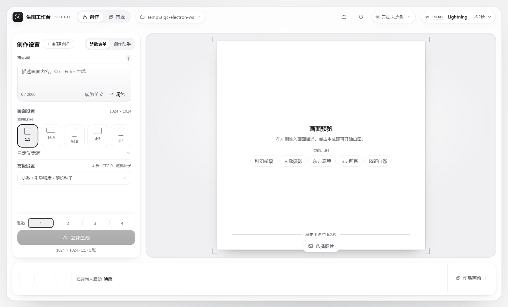
  <p><sub>Main workbench: parameters, preview, inpainting, and version history</sub></p>
</div>

---

## Showcase

The images below were generated with the open-source models included in AIGC Studio. The benchmark uses the same prompts for every model so that style, detail, and text rendering can be compared under the same conditions.

[Nine-dimension benchmark prompts](docs/MODEL_BENCHMARK_PROMPTS.md) · [Online A/B comparison](https://aigc-studio-8rj.pages.dev/en/models)

<table>
<tr>
<td width="50%">
<div align="center">
  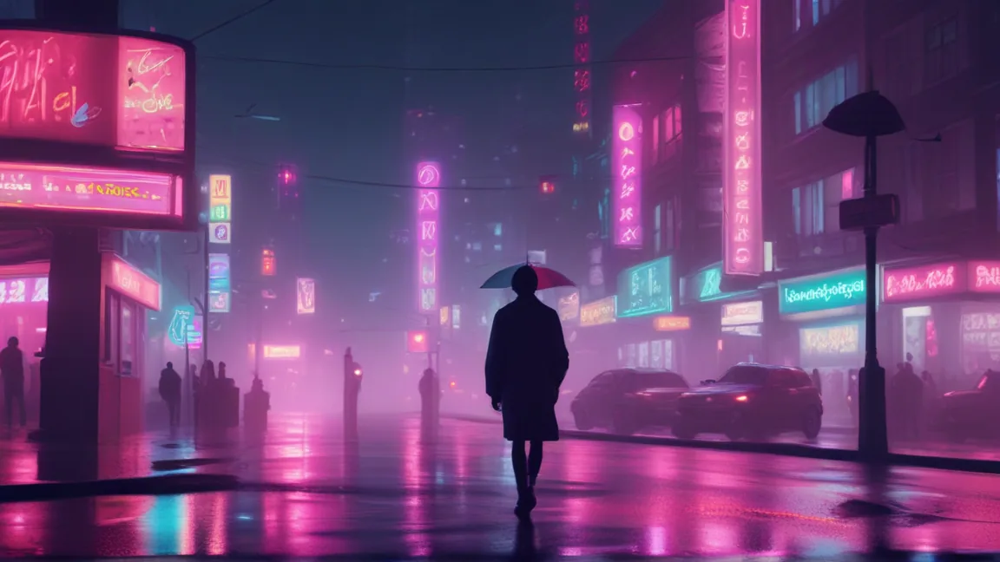
  <p><sub>SDXL Lightning · rainy neon street · Kaggle 2×T4 · about 9.8 s</sub></p>
</div>
</td>
<td width="50%">
<div align="center">
  
  <p><sub>FLUX.2 Klein 4B · minimal Kyoto travel poster · Kaggle 2×T4 · about 6.8 s</sub></p>
</div>
</td>
</tr>
<tr>
<td width="50%">
<div align="center">
  
  <p><sub>FLUX.2 Klein 9B · golden-hour clockmaker workbench · Colab L4 · 113.1 s</sub></p>
</div>
</td>
<td width="50%">
<div align="center">
  
  <p><sub>SANA-Sprint 1.6B · red-crowned crane and lotus pond · Colab L4 · 4.07 s</sub></p>
</div>
</td>
</tr>
</table>

<table>
<tr>
<td width="33.3%">
<div align="center">
  
  <p><sub>Z-Image Turbo · old bookshop in a rainy alley · Colab L4 · 29.19 s</sub></p>
</div>
</td>
<td width="33.3%">
<div align="center">
  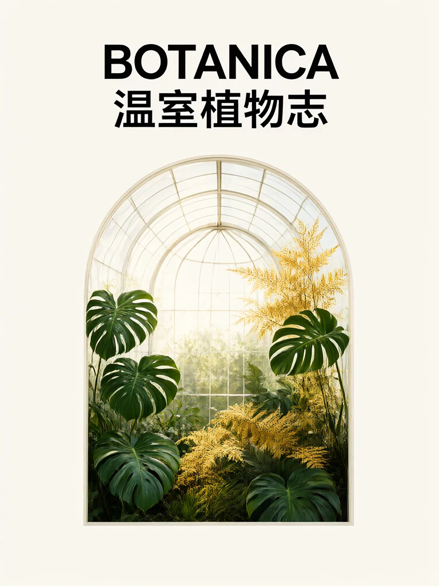
  <p><sub>Qwen-Image 2.1 · greenhouse botany poster · Colab L4 · 39.25 s</sub></p>
</div>
</td>
<td width="33.3%">
<div align="center">
  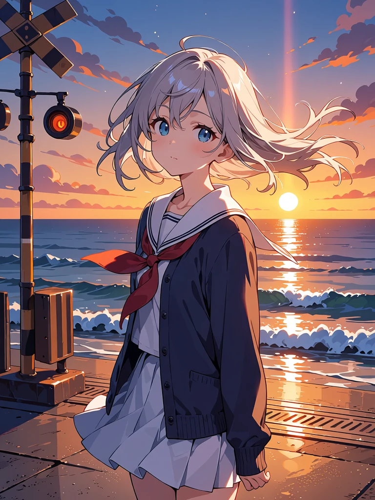
  <p><sub>Anima Turbo v1.1 · girl at a seaside station at dusk · Colab L4 · 9.81 s</sub></p>
</div>
</td>
</tr>
</table>

### Different creative domains

<table>
<tr>
<td width="33.3%">
<div align="center">
  
  <p><sub>Portrait photography · light and skin texture</sub></p>
</div>
</td>
<td width="33.3%">
<div align="center">
  
  <p><sub>Graphic poster · Chinese and English typography</sub></p>
</div>
</td>
<td width="33.3%">
<div align="center">
  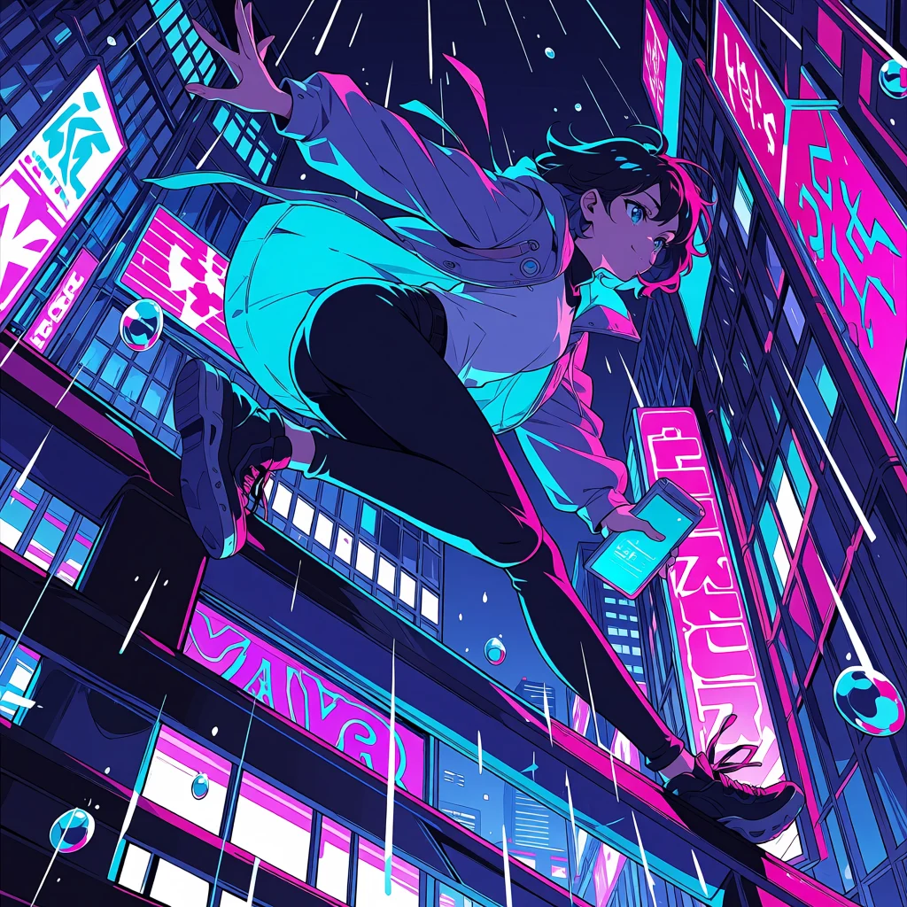
  <p><sub>Game art · anime character illustration</sub></p>
</div>
</td>
</tr>
<tr>
<td width="33.3%">
<div align="center">
  
  <p><sub>Concept design · large-scale science-fiction scene</sub></p>
</div>
</td>
<td width="33.3%">
<div align="center">
  
  <p><sub>3D miniature · isometric diorama</sub></p>
</div>
</td>
<td width="33.3%">
<div align="center">
  
  <p><sub>Material rendering · glass and crystal refraction</sub></p>
</div>
</td>
</tr>
</table>

### Same-prompt benchmark: Chinese aesthetics

<table>
<tr>
<td width="25%">
<div align="center">
  
  <p><sub>Qwen-Image 2.1</sub></p>
</div>
</td>
<td width="25%">
<div align="center">
  
  <p><sub>Z-Image Turbo</sub></p>
</div>
</td>
<td width="25%">
<div align="center">
  
  <p><sub>FLUX.2 Klein 4B</sub></p>
</div>
</td>
<td width="25%">
<div align="center">
  
  <p><sub>SDXL Lightning</sub></p>
</div>
</td>
</tr>
</table>

### Editing workflow: inpaint, outpaint, references, and upscale

<table>
<tr>
<td width="25%">
<div align="center">
  
  <p><sub>Inpainting</sub></p>
</div>
</td>
<td width="25%">
<div align="center">
  
  <p><sub>Outpainting (LoRA)</sub></p>
</div>
</td>
<td width="25%">
<div align="center">
  
  <p><sub>Multiple references (2 refs)</sub></p>
</div>
</td>
<td width="25%">
<div align="center">
  
  <p><sub>2× upscale</sub></p>
</div>
</td>
</tr>
</table>

---

## Compute providers

If your local GPU is not enough, hand the inference job to a cloud provider. The active source can be changed from the workbench to match the model and task.

| Provider | Typical hardware | Cost | Best for |
| :--- | :--- | :--- | :--- |
| **Kaggle** (default) | 2× Tesla T4 | Free quota | Everyday open-source generation and batch jobs |
| **Google Colab** | T4 / L4 / A100 | Free / Pro | Models that need more VRAM |
| **SaladCloud** | RTX 3060–A6000 | Per second | Renting a GPU only when you need it |
| **Commercial APIs** | SiliconFlow / ModelScope / fal.ai / OpenAI | Usage based | Immediate image or video generation |
| **Private worker** | Linux / RunPod / Vast.ai | Your own cost | An existing server or GPU |
| **Local Vulkan** | AMD / Intel / Nvidia | No extra compute fee | Offline generation with selected GGUF models |

Kaggle is configured for a dual-T4 environment and provides 30 free GPU hours per week to eligible verified accounts. A cloud session is shut down automatically after 30 minutes of inactivity. When the window is closed while a task is running, the application stays in the system tray. Choosing **Quit completely** cleans up the related cloud instance or container so that a forgotten session does not continue consuming quota.

<table>
<tr>
<td width="50%">
<div align="center">
  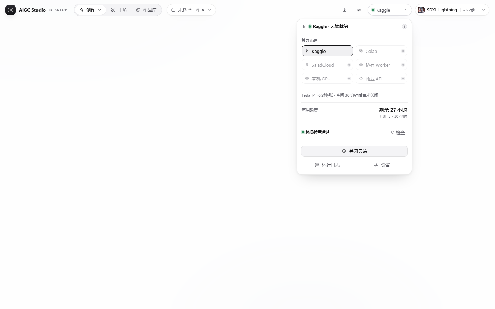
  <p><sub>Switch between free, per-second, commercial, and local compute from the top bar</sub></p>
</div>
</td>
<td width="50%">
<div align="center">
  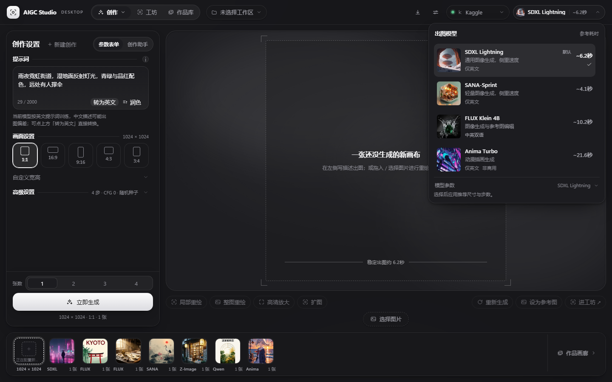
  <p><sub>Dark model picker grouped by compute provider with measured references</sub></p>
</div>
</td>
</tr>
</table>

---

## Features

### 1. Image and video generation

- **Image editing**: inpainting, full-image regeneration, 2× upscaling, outpainting, and multiple reference images. `FLUX.2 Klein` and `Qwen-Image 2.1` support references with an alpha channel.
- **Video generation**: SiliconFlow MiniMax H3 supports text-to-video and first/last-frame-to-video workflows. The first or last frame can be extracted and sent back to the image editor.
- **Batch jobs**: submit several jobs at once, follow inference steps in real time, reorder queued jobs, or cancel them.
- **Version history**: repeated edits, outpaints, and upscales are organized as a version tree so that an earlier result can be revisited or reused.

<table>
<tr>
<td width="50%">
<div align="center">
  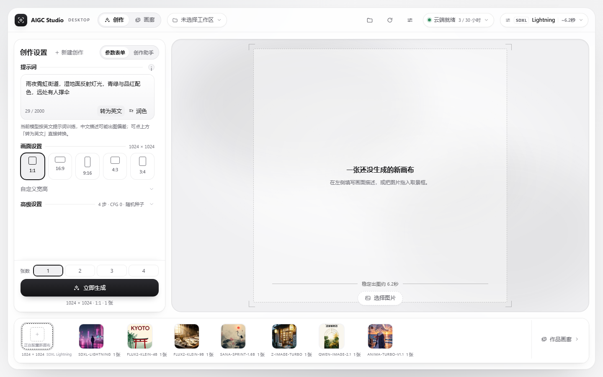
  <p><sub>Light theme: parameter rail, live canvas, and version filmstrip</sub></p>
</div>
</td>
<td width="50%">
<div align="center">
  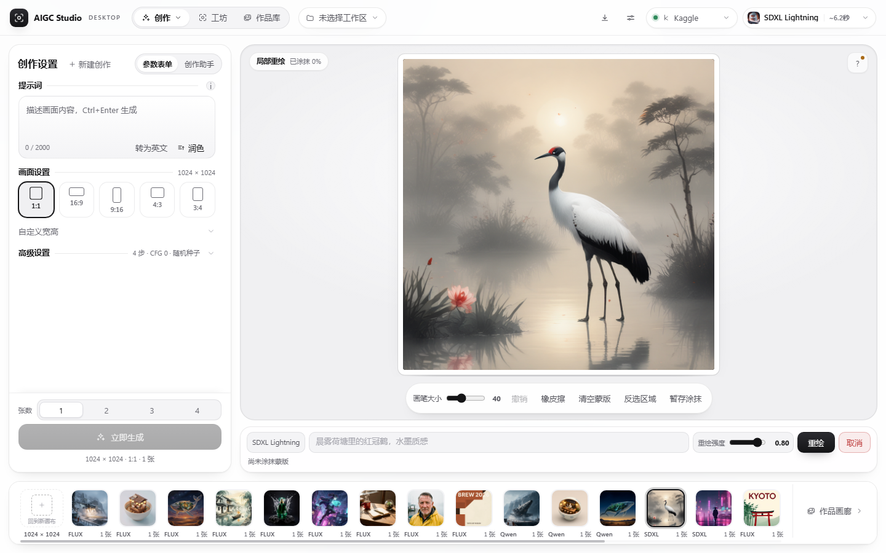
  <p><sub>Inpainting: brush mask and local regeneration workflow</sub></p>
</div>
</td>
</tr>
</table>

<div align="center">
  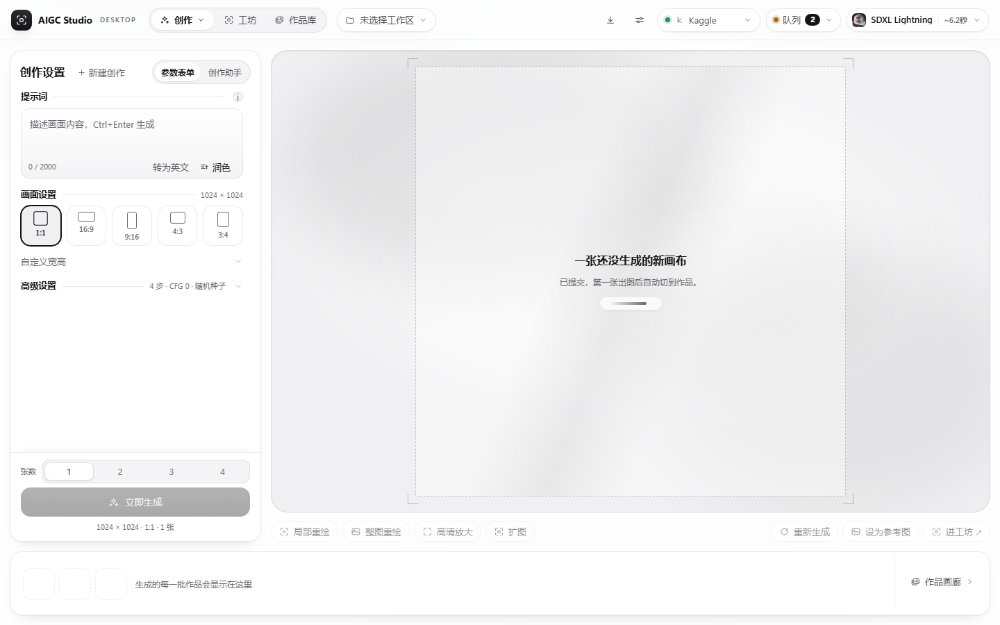
  <p><sub>Batch queue and real-time inference step reporting</sub></p>
</div>

### 2. Creative assistant

Describe an idea in natural language and the assistant can organize a prompt, recommend a model, and propose an image-generation plan.

- **Generation proposals**: turns a Chinese or English request into an English prompt, recommends a model, and shows an editable proposal card before submitting a job.
- **Image analysis**: reads an existing generated image and suggests prompt changes for the next round.
- **Multi-round tests**: set the number of images and a budget, then run several comparisons automatically before continuing with a selected result.
- **Model services**: supports 12 LLM providers, including DeepSeek, Kimi, Qwen, SiliconFlow, ModelScope, OpenRouter, Gemini, OpenAI, Anthropic, and local Ollama. Configure an API key to load the provider's model list.

Without an LLM API key, the assistant falls back to local rules for prompt organization and completion.

<div align="center">
  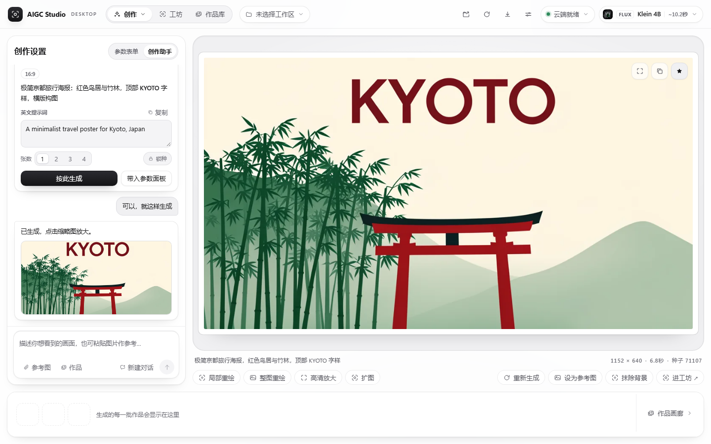
  <p><sub>Organize prompts and generation plans through a conversation</sub></p>
</div>

### 3. Asset Workshop

Generated images often need production cleanup, especially when they are used as game assets. The Asset Workshop handles common post-processing tasks in the same application.

| Tool | What it does | Output |
| :--- | :--- | :--- |
| **Pixel alignment** | Detects the pixel grid, organizes colors, and cleans stray edge pixels | Clean pixel art |
| **Sprite-sheet slicing** | Splits a character sheet by rows and columns and previews the animation | `spritesheet`, `atlas.json` |
| **Seamless tiling** | Repairs texture edges to reduce visible seams when tiled | Seamless texture |
| **SVG vectorization** | Converts flat artwork into editable vector paths | `.svg` |
| **Background removal** | Removes backgrounds with built-in `RMBG-1.4` or cloud `BiRefNet` / `RMBG-2.0` | Transparent PNG |
| **PBR material decomposition** | Extracts albedo, normal, roughness, and metallic channels from one image | Four material maps |
| **Spatial FX (`depth-fx`)** | Real-time depth fog, aerial perspective, click-to-focus DoF, and 2.5D parallax | Lit image + `depth` / `normal` channels |
| **Dynamic relighting** | Draggable 3D light orb (WebGL/CPU) or `IC-Light` AI relighting | Relit image + reusable lighting channels |

Pixel alignment, sprite-sheet slicing, seamless tiling, SVG vectorization, spatial FX, and physical relighting run locally without a cloud GPU (`depth-fx` defaults to the ~37 MB `DA3-Small` ONNX model). Background removal runs on-device via `RMBG-1.4` (WebGPU/WASM) with optional cloud `BiRefNet` / `RMBG-2.0`; PBR decomposition supports local CUDA (8 GB+ NVIDIA GPU) or cloud GPUs, and `IC-Light` relighting runs on cloud GPUs.

<details>
<summary>Optional local vision component</summary>

The Workshop uses local rules to recommend a tool by default. If visual assistance is enabled, the first use downloads approximately 22.9 MB of MobileCLIP-S0 FP16 weights. It analyzes local 256×256 thumbnails and does not upload images.

This component is covered by the Apple ML-MobileCLIP License and is currently not declared for commercial use. If the download fails, or if `AIGC_STUDIO_WORKSHOP_VISION=0` is set, the application uses the basic rule-based path without affecting other tools.

</details>

<table>
<tr>
<td width="50%">
<div align="center">
  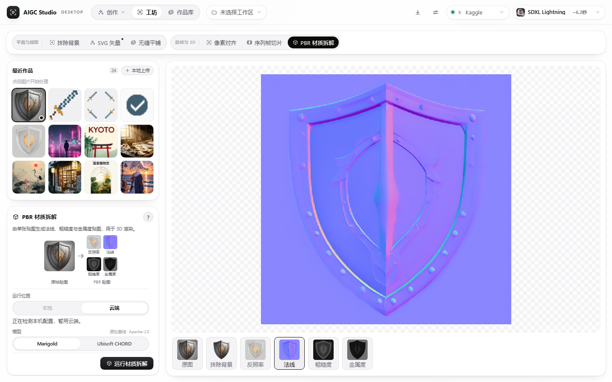
  <p><sub>PBR decomposition: albedo, normal, roughness, and metallic channels</sub></p>
</div>
</td>
<td width="50%">
<div align="center">
  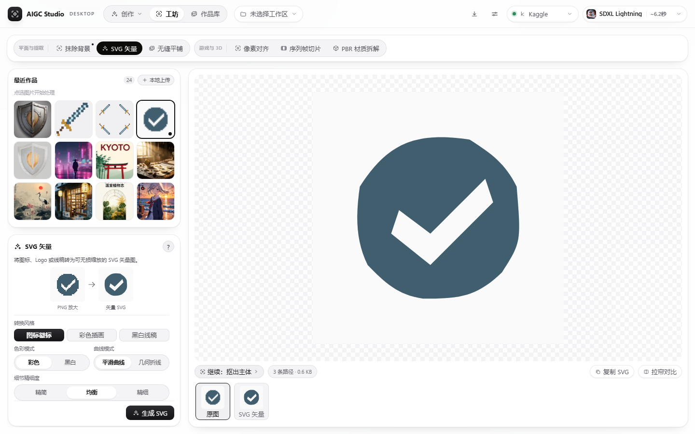
  <p><sub>SVG vectorization with path statistics and before/after comparison</sub></p>
</div>
</td>
</tr>
</table>

### 4. MCP for Claude Desktop and Cursor

The repository includes an MCP server ([`mcp/server.mjs`](mcp/server.mjs)). MCP-compatible clients such as Claude Desktop and Cursor can use it to call local image generation, batch generation, and upscaling.

The MCP server connects to the running desktop application and shares its current compute session and `outputs/` directory.

Generate a client configuration with:

```powershell
npm run mcp:config
```

See the [MCP guide](mcp/README.md) for client-specific configuration.

### 5. Local archive and security

- **Local files**: images, videos, and `meta.json` generation parameters are saved under `outputs/<YYYYMMDD-HHmmss>-<jobId>/`. The gallery can filter by time and favorites and reuse parameters from an earlier image.
- **Local service**: the service listens on `127.0.0.1` by default and creates a random authentication token on every launch.
- **Key storage**: API keys are encrypted with Electron `safeStorage` and AES-256-GCM. They are not written to configuration files in plain text.

<div align="center">
  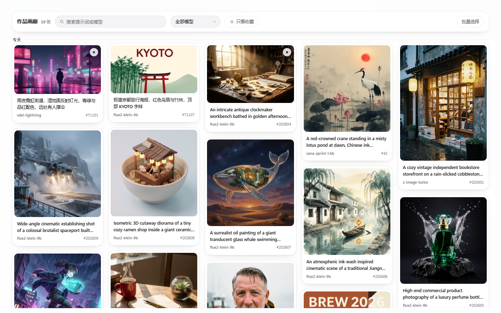
  <p><sub>Local gallery: review images, models, and generation parameters</sub></p>
</div>

---

## Built-in models

Model definitions live in [`models/`](models/). The current release includes eight open-source models.

| Model | Highlights | Available compute | License |
| :--- | :--- | :--- | :--- |
| `SDXL Lightning` | Default model; four-step generation with image-to-image and inpainting | Kaggle / Colab / Salad / private worker | OpenRAIL++ |
| `RealVisXL V5 Lightning` | Four-step generation at 1024² in about 44–49 s, including locally | Kaggle / Colab / Salad / private worker / local GPU | CreativeML OpenRAIL++-M |
| `SANA-Sprint 1.6B` | Two-step generation; about 4 s at 1024 px for fast composition tests | Kaggle / Colab / Salad / private worker | Apache-2.0 |
| `FLUX.2 Klein 4B` | Four-step generation with Chinese prompts, multiple references, and outpainting | Kaggle / Colab / Salad / private worker / local GPU | Apache-2.0 |
| `Anima Turbo v1.1` | 2B anime model supporting natural language and Danbooru tags | Kaggle / Colab / Salad / private worker | CircleStone Labs non-commercial |
| `Z-Image Turbo` | 6B photorealistic model with strong Chinese and English sign text and inpainting | Colab / Salad / private worker / local GPU | Apache-2.0 |
| `Qwen-Image 2.1` | Chinese typography and poster design, with transparent multiple references | Colab / Salad / private worker | Qwen Research (non-commercial) |
| `FLUX.2 Klein 9B` | Strong still-life materials and lighting for detailed edits | Colab / Salad / private worker (HF authorization required) | FLUX Non-Commercial |

Commercial APIs provide additional models:

- **SiliconFlow**: `Qwen-Image`, `Kolors`, `FLUX.1`, and MiniMax H3 video.
- **ModelScope**: `API-Inference` image generation plus ModelScope Hub mirror support for weight downloads.
- **fal.ai**: `FLUX 1.1 Pro`.
- **OpenAI**: `GPT Image 1` and `DALL·E 3`.

---

## More guides and comparisons

- Project site: [aigc-studio-8rj.pages.dev/en](https://aigc-studio-8rj.pages.dev/en) ([model benchmarks](https://aigc-studio-8rj.pages.dev/en/models) · [Asset Workshop](https://aigc-studio-8rj.pages.dev/en/workshop) · [all guides](https://aigc-studio-8rj.pages.dev/en/guides))
- Guides:
  - [Run open-source image models with a free GPU and no ComfyUI](https://aigc-studio-8rj.pages.dev/en/guides/free-gpu-no-comfyui)
  - [When should you use AIGC Studio or ComfyUI?](https://aigc-studio-8rj.pages.dev/en/guides/aigc-studio-vs-comfyui)
  - [Turn AI pixel art into a game-ready sprite atlas](https://aigc-studio-8rj.pages.dev/en/guides/ai-pixel-art-sprite)
  - [Convert an AI illustration to an editable SVG without local VRAM](https://aigc-studio-8rj.pages.dev/en/guides/ai-image-to-svg)
  - [Generate images from Claude Desktop or Cursor through MCP](https://aigc-studio-8rj.pages.dev/en/guides/mcp-claude-cursor-image)

---

## Installation

### Option A: download a Windows x64 release

Download the latest build from [GitHub Releases](https://github.com/nanxfu/aigc-studio/releases/latest):

- `aigc-studio-<version>-x64.exe`: standard installer with a desktop shortcut and in-app update checks.
- `aigc-studio-<version>-portable.exe`: portable build; download and run it without installation.

macOS and Linux users can start the application from source.

### Option B: run from source (Windows / macOS / Linux)

Node.js 20 or newer is required; Node.js 22 or newer is recommended. Python 3.10+ is only needed when running your own GPU worker or Python unit tests.

```powershell
git clone https://github.com/nanxfu/aigc-studio.git
cd aigc-studio

npm install
Copy-Item .env.example .env

# Start the complete desktop client
npm run dev
```

For isolated frontend hot-reload debugging, use two terminals:

```powershell
npm run dev:server          # Terminal 1: local service (127.0.0.1:5130)
npm run dev:web             # Terminal 2: Vite frontend (http://127.0.0.1:5173)
```

### Build a desktop package yourself

```powershell
# Build an unpacked directory (release/win-unpacked/)
npm run pack

# Build the Windows installer and portable executable (release/)
npm run dist
```

### In-app updates and manual checks

For NSIS installations, enabling **Automatic checks** checks for an update 10 seconds after launch and then every six hours. The application only checks; downloading and installing still require confirmation. Portable, unpacked, and development builds show a notification and open the release page. You can disable checks or set a self-hosted `https://` update mirror under **Settings → Version and updates**.

| Situation | Details |
| :--- | :--- |
| SmartScreen says “Unknown publisher” | The open-source builds do not currently use a code-signing certificate. If the installer came from this repository's Releases page, choose **More info → Run anyway**. |
| Verify an installer manually | Releases include `SHA256SUMS.txt`. On Windows run `certutil -hashfile <exe> SHA256`; on macOS / Linux run `shasum -a 256 <exe>` and compare the digest. |
| Install while a cloud job is running | **Restart and install now** is blocked while a cloud session or queued job is active, preventing Kaggle / Colab quota from being consumed unexpectedly. Wait for the task or choose **Install on exit**. |
| GitHub is slow or unreachable | Set a custom `https://` mirror in **Version and updates**, or enable your system proxy. |

---

## FAQ

<details>
<summary>Q1: Does AIGC Studio cost money? Is 30 free GPU hours per week enough?</summary>

The application is open source under the MIT License. The default compute source is Kaggle's free weekly quota for accounts with a verified phone number (2×T4 with 30 GB of VRAM). This is enough for personal exploration and everyday creation. Switch to a usage-based provider such as SiliconFlow when you need immediate generation or video.
</details>

<details>
<summary>Q2: Do I need a discrete GPU?</summary>

No. The default models run on Kaggle, Colab, a private worker, or a commercial API. Your computer handles the interface, LLM routing, local archive, and zero-VRAM Workshop operations. For a fully offline workflow, prepare the local inference engine in Settings, then download a supported text-to-image model from the top bar picker. NVIDIA GPUs prepare CUDA on demand; AMD and integrated GPUs use the bundled Vulkan engine. Speed depends on GPU bandwidth and available VRAM or system memory.
</details>

<details>
<summary>Q3: Why does the first launch take several minutes?</summary>

Kaggle and Colab cold starts allocate an instance, check the environment, and download model weights. This usually takes 3–10 minutes. Once the session is ready, subsequent images take seconds. Sessions shut down after 30 minutes of inactivity and can also be stopped manually. Choose **Commercial API** when you need to avoid cold-start time.
</details>

<details>
<summary>Q4: Are images and API keys uploaded to a third-party image host?</summary>

No. Images generated remotely are sent back through an encrypted temporary Bearer Token tunnel for that session (or downloaded directly from the commercial API) and then saved to your local `outputs/` directory. API keys and worker tokens are encrypted in the local system keychain.
</details>

---

## Development and testing

| Operation | Command | Description |
| :--- | :--- | :--- |
| Run all offline tests | `npm test` | Contract, client, host, and Electron smoke tests |
| Worker unit tests | `python test/worker/run.py` | Offline tests for the Python GPU execution layer |
| Contract / model / icon checks | `npm run contract:check` / `npm run models:check` / `npm run icons:check` | Validate API contracts, model assets, and icon completeness |
| Packaged smoke tests | `npm run test:packaged` / `npm run test:installer` | Check `win-unpacked` and NSIS silent install / uninstall (run `npm run dist` first) |
| Release checks | `node tools/check-release-version.mjs` / `npm run release:verify` | Check tag, `package.json`, contract versions, and `latest.yml` digests |
| Read-only Kaggle probe | `npm run kaggle:probe` | Check local Kaggle credentials and remaining quota without consuming it |
| Live GPU acceptance | `node test/gpu-live.mjs` | Full cloud-GPU acceptance test (uses quota) |

---

## Community

- Author: **Lumen** (`Lumen流明` on Douyin, account `42906749348`)
- **AIGC Studio QQ group**: `1129644492`

<div align="center">
  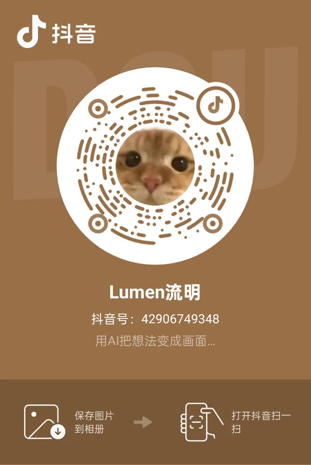
  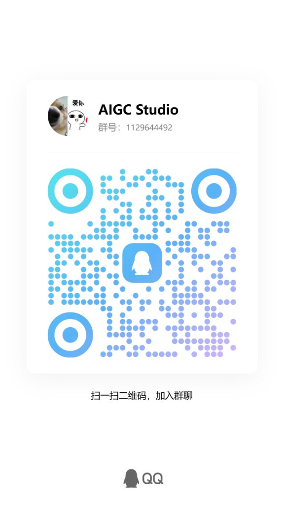
</div>

---

## License and acknowledgements

- AIGC Studio is released under the **MIT License** (see [`package.json`](package.json)).
- Thanks to Kaggle and Google Colab for providing cloud GPU access for developers.
- Thanks to the Hugging Face `diffusers` ecosystem, `@visioncortex/vtracer`, [`pi-ai` / `pi-agent-core`](https://github.com/badlogic/pi-mono), and the teams behind the open-source models used by this project.

