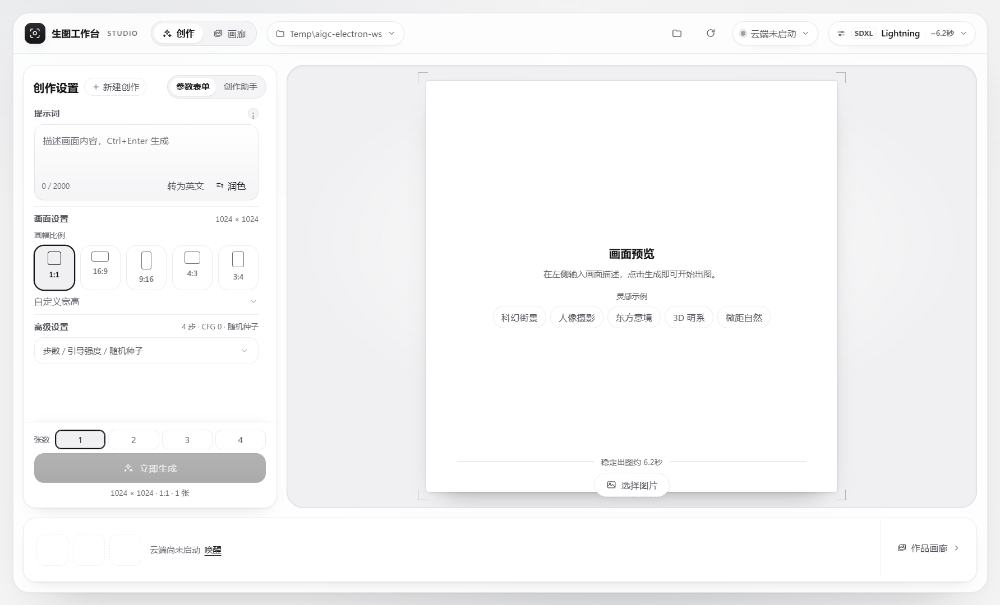

<div align="center">

# AIGC Studio


**界面留在本地，算力交给云端。**<br/>
开源桌面端 AIGC 创作工作台（Electron + React + 本地 Node.js 控制面）。<br/>
不依赖本地独显与 Python / ComfyUI 环境，可接入 Kaggle / Colab 免费 GPU、商业生图与视频 API 或私有 GPU Worker，内置 6 项本地资产处理工具。

[](https://github.com/nanxfu/aigc-studio/releases)
[](https://aigc-studio-8rj.pages.dev)
[](https://www.electronjs.org/)
[](package.json)
[](https://github.com/nanxfu/aigc-studio)
<a href="https://linux.do/"></a>

[官网与指南](#官网与使用指南) · [算力后端](#算力后端支持) · [核心功能](#核心功能) · [快速开始](#快速开始) · [常见问答](#常见问答) · [开发与测试](#开发与测试)

</div>

---

## 简介

AIGC Studio 的界面与资产在本地，推理默认在云端；有本机显卡时也可切换到本机 Vulkan：

- 本地只运行 Electron 客户端和监听 `127.0.0.1` 的 Node.js 控制面。无需独显，也不用安装 PyTorch、CUDA 或 ComfyUI；本机 GPU 走 `stable-diffusion.cpp` Vulkan 预编译包 + GGUF，零 Python 依赖。
- 算力来源可随时切换。日常用商业 API，按张 / 按条计费，支持文生图与文生 / 图生视频；批量生成或局部重绘可接 Kaggle 免费双卡（每周 30 小时）、Google Colab、私有远端 Worker，或本机 Vulkan 文生图。
- 所有产物保存在你指定的工作区 `outputs/` 目录：原图、视频、`meta.json` 参数、版本树与工坊衍生文件。

<div align="center">
  
  <p><sub>独立桌面工作台：无边框自绘标题栏 + 左侧参数面板 + 舞台预览 + 底部作品条</sub></p>
</div>

---

## 官网与使用指南

- 项目官网：[aigc-studio-8rj.pages.dev](https://aigc-studio-8rj.pages.dev)（[模型实测](https://aigc-studio-8rj.pages.dev/models) · [资产工坊](https://aigc-studio-8rj.pages.dev/workshop) · [全部指南](https://aigc-studio-8rj.pages.dev/guides)）
- 场景指南：
  - [无独立显卡运行开源生图模型](https://aigc-studio-8rj.pages.dev/guides/free-gpu-no-comfyui)
  - [AIGC Studio 与 ComfyUI 选型对照](https://aigc-studio-8rj.pages.dev/guides/aigc-studio-vs-comfyui)
  - [游戏像素画网格对齐与序列帧 Atlas 导出](https://aigc-studio-8rj.pages.dev/guides/ai-pixel-art-sprite)
  - [零显存将 AI 插画转为可编辑 SVG](https://aigc-studio-8rj.pages.dev/guides/ai-image-to-svg)
  - [通过 MCP 在 Claude Desktop / Cursor 中调用本地生图](https://aigc-studio-8rj.pages.dev/guides/mcp-claude-cursor-image)

---

## 算力后端支持

| 后端 | 状态 | 算力规格 | 成本 / 门槛 | 说明 |
| :--- | :---: | :--- | :--- | :--- |
| Kaggle GPU Driver | 内置（默认） | 2×Nvidia Tesla T4（30GB 显存） | 免费（每周 30 小时额度） | 自动会话管理、隧道会合、协议 v2 步数回传与空闲关机 |
| Google Colab Driver | 已接入 | Nvidia T4（免费）/ L4、A100（Pro） | 免费 / 订阅 | 内置 OAuth 授权；支持 `Z-Image Turbo`、`Qwen-Image 2.1`、`FLUX.2 Klein 9B` |
| 商业 API（`cloud-api`） | 内置 | 硅基流动 / fal.ai / OpenAI / 自定义端点 | 按张 / 按条计费 | 无冷启动；支持文生图与硅基流动视频（MiniMax H3 文生 / 首尾帧视频） |
| 私有远端 Worker | 内置 | 自建 Linux GPU / RunPod / Vast.ai | 按需计费 / 私有部署 | 长驻 HTTP 服务 + Bearer 鉴权；提供 Docker 镜像与 binary 产物，SSE 回传步数 |
| 本机直连 GPU（`local-gpu`） | 可用（Vulkan 文生图） | AMD / Intel Vulkan 核显或独显 | 本地硬件 | `stable-diffusion.cpp` + GGUF，只监听 `127.0.0.1`；当前支持文生图，图生图待续 |

> Kaggle / Colab 会话活跃时，关闭窗口默认最小化到系统托盘，防止误关烧掉算力额度；通过托盘「彻底退出」会完成远端关机与会话清理。

---

## 核心功能

### 1. 创作工作台（生图 / 视频）

* 内置 8 款开源生图模型（见[常见问答](#常见问答)与 [`models/*.json`](models/)），切换到商业 API 时自动加载对应服务商的生图与视频预设。
* 参数面板随当前模型能力展示提示词、画幅、步数、引导强度与参考图入口；支持中译英及光影、材质、构图、氛围词缀；参数修改未提交时，舞台同步显示取景分叉预览。
* 图片支持局部涂抹重绘（Inpaint）、整图重绘、高清放大（×2）与扩图（Outpaint LoRA）；视频支持原生播放，可抽取首帧 / 尾帧保存为普通作品，继续二次创作。
* 底部作品条按来源血缘折叠版本树并保留草稿；顶栏可随时切换本地工作区。

<div align="center">
  
  <p><sub>深色 / 浅色主题切换：参数面板 + 实时画布 + 版本胶卷</sub></p>
</div>

### 2. 创作助手与自动探索

* 对话式创作助手根据自然语言润色英文提示词、匹配模型与算力来源，先输出可编辑的提案卡（`ui_propose_generation`）或澄清卡（`ui_ask_clarify`），确认后可跨模型、跨后端切换并生成。未配置 LLM Key 时回落本地规则引擎。
* 支持通过 `imagen_inspect` 回看已生成成图，按四维规范改词；探索方案（`ui_propose_explore`）授权后，在轮数与总张数预算内自动多轮生成，实时显示进度，支持并排对比与选图变体回流。
* 内置 11 家 LLM 服务商：DeepSeek、Kimi、通义千问、硅基流动、OpenCode Zen、OpenRouter、Google Gemini、OpenAI、Anthropic、Ollama 及自定义 OpenAI 兼容端点，支持拉取模型列表。

<div align="center">
  
  <p><sub>创作助手单轨对话与可编辑提案卡</sub></p>
</div>

### 3. 资产工坊（6 项后处理）

生成后无需导出到外部软件。顶栏切入「工坊」，本地静默识别作品类型并高亮推荐工具，结果以复合资产包（主图 + 附属通道 + 版本树继承）落盘，可导出整包 ZIP：

| 工具 | 执行位置 | 核心能力与产出 |
| :--- | :---: | :--- |
| SVG 矢量转换 | 本机 | 基于 `@visioncortex/vtracer`（Node WASM），离线将扁平插画 / Logo 转为可编辑 `.svg` 路径 |
| 像素对齐 | 本机 | 边缘周期网格自动探测 + Oklab 调色盘量化 + Alpha 硬边清理，修复 AI 像素画虚边与混色 |
| 序列帧切片 | 本机 | 自定义行列网格切片，逐帧动画实时预览，导出 `spritesheet` 与 `atlas.json` |
| 无缝平铺 | 本机 | 左右 / 上下边缘 MAE 接缝检测 + 余弦混边 + 2×2 实时贴图校验 |
| 抹除背景 | 云端 GPU | 默认 `BiRefNet`（MIT，免登录），可选 `RMBG-2.0`（非商用，需 HF 授权），输出 RGBA 透明底 PNG |
| PBR 材质拆解 | 云端 GPU | 基于 `Marigold`（Apache-2.0），拆出 `albedo / normal / roughness / metallic` 四通道贴图 |

> 工坊首屏推荐先由本地规则完成；可选的 L2 视觉补证也只在本机 Host 执行，渲染进程只提交当前画面的 256×256 RGB。首次使用会从固定地址下载约 22.9 MB 的 MobileCLIP-S0 FP16 权重并校验 SHA-256；该权重受 Apple ML-MobileCLIP License 约束，当前不声明可商用。下载、校验或推理失败（以及设置 `AIGC_STUDIO_WORKSHOP_VISION=0`）时自动保持 L1，不影响任何工具。

### 4. MCP 接入

* `mcp/server.mjs` 通过 stdio 暴露 7 个 `imagen_*` 工具（`imagen_generate` / `batch` / `upscale` / `history` / `cancel` / `session` / `recipes`），可接入 Claude Desktop、Cursor 等外部 Agent。
* 与桌面端共享队列、算力会话和 `outputs/` 目录：通过 `runtime.json` 自动发现本机回环端口与 Token。运行 `npm run mcp:config` 可打印现成配置（详见 [`mcp/README.md`](mcp/README.md)）。

### 5. 画廊与本地安全

* 所有产物与参数 `meta.json` 按 `outputs/<YYYYMMDD-HHmmss>-<jobId>/` 落盘，支持按日期浏览、搜索、收藏与批量管理。
* 控制面仅监听 `127.0.0.1`，每次启动生成 256-bit 随机 Bearer Token；LLM Key、商业 API Key 与 Worker Token 均通过 Electron `safeStorage` + AES-256-GCM 加密保存；`/api/file` 使用同源 `HttpOnly; SameSite=Strict` 会话 Cookie 与 HTTP Range 流式传输（支持视频拖动）；渲染进程开启 `contextIsolation` 与 `sandbox`。

<div align="center">
  
  <p><sub>作品画廊：本地归档、收藏筛选与参数回溯</sub></p>
</div>

---

## 快速开始

### 方式 A：下载桌面安装包（Windows x64）

前往 [GitHub Releases](https://github.com/nanxfu/aigc-studio/releases/latest) 下载最新版本（macOS / Linux 请用下方方式 B 从源码运行）：

* `aigc-studio-<version>-x64.exe`：Windows 安装版，支持创建桌面快捷方式与应用内更新检查
* `aigc-studio-<version>-portable.exe`：免安装便携版，单文件运行，不写注册表，更新需手动下载替换

### 方式 B：从源码运行（Windows / macOS / Linux）

环境要求：

* Node.js ≥ 20（推荐 22+）
* Python 3.10+（仅 GPU Worker 端或 Python 单测需要）
* 算力凭据（按需）：Kaggle 凭据（内置 OAuth 登录或 `~/.kaggle/kaggle.json`）、Google Colab 授权，或硅基流动 / fal / OpenAI 的 API Key

```powershell
git clone https://github.com/nanxfu/aigc-studio.git
cd aigc-studio

npm install
Copy-Item .env.example .env
```

选择以下任一方式启动：

```powershell
# 方式一：完整桌面客户端（Electron 窗口 + 本地 Node 服务）
npm run dev

# 方式二：浏览器开发模式（适合前端热更新调试）
npm run dev:server          # 终端 1：启动本地服务（默认 127.0.0.1:5130）
npm run dev:web             # 终端 2：启动 Vite 前端（默认 http://127.0.0.1:5173）
```

### 首次配置与出图

1. 启动后打开右上角「设置」：
   - 选择或新建本地工作区目录；
   - （可选）配置创作助手模型：11 家服务商选其一，填入 API Key 后点「获取模型」；
   - 选择算力来源：
     - Kaggle / Colab：完成授权后点顶部「开机 / 唤醒云端」，首次冷启动约 3~10 分钟，用于分配 GPU 与加载权重；
     - 商业 API：选择硅基流动 / fal.ai / OpenAI / 自定义端点并填 Key，配置后即可生图或生成视频；
     - 私有 Worker：填写 Worker 地址与 Bearer Token，测试连接即可使用；
     - 本机 GPU：在应用数据目录放置 `local-gpu.json`（`sd-server` + GGUF 模型路径），选择「本机 GPU」后连接即可；详见 [`docs/LOCAL_GPU_VULKAN_PLAN.md`](docs/LOCAL_GPU_VULKAN_PLAN.md)。
2. 状态就绪后，在左侧输入提示词或通过右侧创作助手生成。生成后可在顶栏切换至「工坊」，完成抠图、转 SVG、像素对齐或 PBR 拆解。

### 自行打包桌面安装包

```powershell
# 构建免安装目录（输出至 release/win-unpacked/）
npm run pack

# 构建 Windows 安装包与单文件便携版（输出至 release/）
npm run dist
```

### 应用内更新与手动校验

安装版（NSIS）开启「自动检查」后，启动 10 秒检查一次新版本，之后每 6 小时复查；只检查，不自动下载，下载与安装均需确认。便携版、解压版与开发态只提示新版本并打开发布页。设置抽屉 →「版本与更新」可关闭自动检查，或切换为自建 `https://` 更新镜像源。

| 情况 | 说明 |
| :--- | :--- |
| SmartScreen 提示「未知发布者」 | 开源版本暂未购买代码签名证书，属预期行为；确认从本仓库 Releases 下载后，点「更多信息 → 仍要运行」。 |
| 手动校验安装包完整性 | Releases 附 `SHA256SUMS.txt`：Windows 运行 `certutil -hashfile <exe> SHA256`，macOS / Linux 运行 `shasum -a 256 <exe>`，比对摘要。 |
| 云端任务运行时能否安装更新 | 有活跃云端会话或排队任务时，「立即重启安装」会被拦截，避免 Kaggle / Colab 继续消耗额度；可等任务结束或选「退出时安装」。 |
| GitHub 直连较慢或失败 | 可在「版本与更新」填写自定义 `https://` 镜像地址，或开启系统代理。 |

---

## 常见问答

<details>
<summary>Q1: 使用 AIGC Studio 要花钱吗？每周 30 小时免费 GPU 够用吗？</summary>

软件本身以 MIT 协议开源。默认算力来自 Kaggle 向已验证手机号用户提供的每周 30 小时免费 GPU（2×T4，30GB 显存），足够个人日常探索与创作。如需免等待出图或生成视频，可切换硅基流动等按次计费的商业 API。
</details>

<details>
<summary>Q2: 我的电脑需要独立显卡吗？</summary>

不强制需要。默认模型加载和推理在云端执行（Kaggle / Colab / 私有 Worker / 商业 API），本地只负责界面展示、LLM 路由、文件归档，以及零显存的本机工坊后处理。若想完全离线，可用本机 Vulkan（`local-gpu`）跑 GGUF 文生图；速度取决于核显带宽与可用内存，当前仅支持文生图。
</details>

<details>
<summary>Q3: 首次开机为什么要等几分钟？</summary>

Kaggle / Colab 冷启动包括分配云端实例、检查运行环境与拉取模型权重三个步骤，通常需要 3~10 分钟。就绪后连续出图只需数秒；默认空闲 30 分钟自动关机，也可随时手动关机。如需免去冷启动等待，可将算力来源切换为「商业 API」。
</details>

<details>
<summary>Q4: 图片和密钥会传到第三方图床吗？</summary>

不会。远端生成的图片经当次会话的临时 Bearer Token 隧道加密传回本地（或由商业 API 直接下载回本机），随即保存到你指定的工作区 `outputs/` 目录；API Key 与 Worker Token 加密存储在本地系统密钥库。
</details>

<details>
<summary>Q5: 目前内置了哪些开源生图模型？有统一评测参考吗？</summary>

模型配置声明在 [`models/*.json`](models/)，当前内置 8 款开源模型（[查看 9 维统一盲测提示词](docs/MODEL_BENCHMARK_PROMPTS.md) · [在线同题 A/B 实测对比](https://aigc-studio-8rj.pages.dev/models)）：

| 模型 | 定位 | 算力来源 | 许可 |
| :--- | :--- | :--- | :--- |
| `SDXL Lightning` | 默认主力；4 步极速出图，支持图生图 / 局部涂抹重绘 | Kaggle / Colab / 私有 Worker | OpenRAIL++ |
| `RealVisXL V5 Lightning` | 本机 Vulkan 4 步写实；1024² 约 44~49 秒 | 本机 GPU（Vulkan GGUF） | CreativeML OpenRAIL++-M |
| `SANA-Sprint 1.6B` | 1.6B 线性 DiT，2 步约 4 秒出 1024px，适合快速构思 | Kaggle / Colab / 私有 Worker | Apache-2.0 |
| `FLUX.2 Klein 4B` | 4 步出图，原生中英双语 + 多图参考 + 扩图 LoRA | Kaggle / Colab / 私有 Worker | Apache-2.0 |
| `Anima Turbo v1.1` | 2B 二次元 DiT，支持自然语言与 Danbooru 标签 | Kaggle / Colab / 私有 Worker | CircleStone Labs 非商用 |
| `Z-Image Turbo` | 6B S3-DiT，写实摄影、中英双语招牌与局部重绘 | Colab / 私有 Worker | Apache-2.0 |
| `Qwen-Image 2.1` | 7B DiT + Qwen3-VL，强中文排版、多图参考（支持 RGBA） | Colab / 私有 Worker | Qwen Research License（非商用） |
| `FLUX.2 Klein 9B` | 9B 蒸馏模型，高精度静物材质与参考图编辑 | Colab / 私有 Worker（HF gated） | FLUX Non-Commercial |

切换到商业 API（`cloud-api`）时，还可使用硅基流动（`Qwen-Image` / `Kolors` / `FLUX.1 schnell & dev` / `MiniMax H3` 视频）、`fal.ai`（`FLUX.1` / `FLUX 1.1 Pro`）与 `OpenAI Images`（`GPT Image 1` / `DALL·E 3`）。
</details>

---

## 开发与测试

| 操作 | 命令 | 说明 |
| :--- | :--- | :--- |
| 运行全部离线测试 | `npm test` | 含 `contract` / `client` / `host` 与 Electron 有图冒烟 |
| Worker 离线单测 | `python test/worker/run.py` | Python GPU 执行端离线测试 |
| 契约 / 模型 / 图标校验 | `npm run contract:check` / `models:check` / `icons:check` | 校验前后端契约、模型资产与图标完整度 |
| 打包产物冒烟测试 | `npm run test:packaged` / `test:installer` | 校验 `win-unpacked` 目录与 NSIS 静默安装 / 卸载（需先 `npm run dist`） |
| Release 版本与产物校验 | `node tools/check-release-version.mjs` / `npm run release:verify` | 校验 Tag / `package.json` / 契约版本一致性与 `latest.yml` 摘要 |
| Kaggle 环境只读探测 | `npm run kaggle:probe` | 检查本地 Kaggle 凭据与剩余 GPU 配额，不消耗配额 |
| 真机 GPU 验收 | `node test/gpu-live.mjs` | 真实云端 GPU 全链路验收（消耗配额） |

---

## 关注作者

作者抖音账号：**Lumen流明**（抖音号 `42906749348`）。打开抖音「扫一扫」关注：

<div align="center">
  
</div>

---

## 开源许可与致谢

- 本项目基于 **MIT License** 开源（见 [`package.json`](package.json)）。
- 感谢 Kaggle 与 Google Colab 为开发者提供云端 GPU 算力支持。
- 感谢 Hugging Face `diffusers`、`@visioncortex/vtracer`、[`pi-ai` / `pi-agent-core`](https://github.com/badlogic/pi-mono) 与各大开源模型团队。
