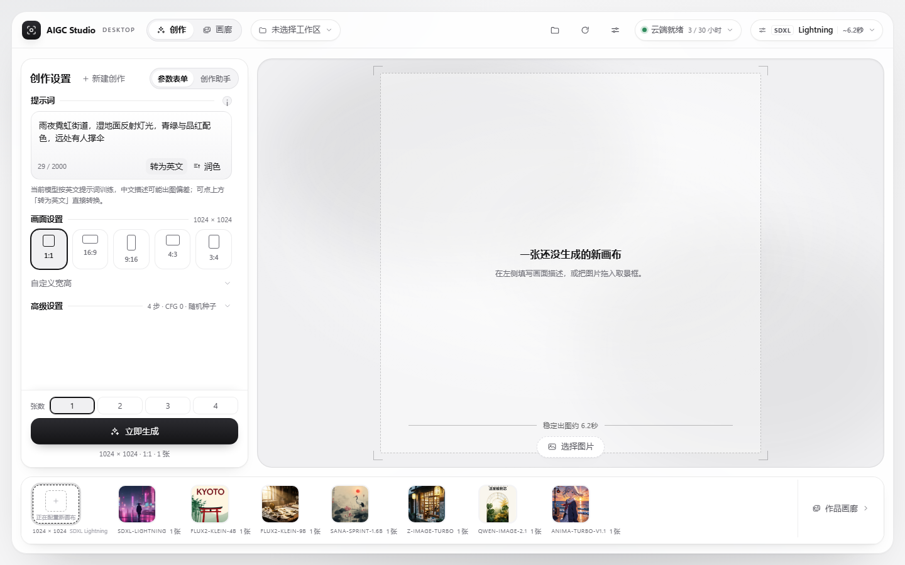

<div align="center">

# AIGC Studio


**独立的开源桌面端 AIGC 创作工作台（Electron + React + 本地 Node.js 控制面）。**<br/>
不依赖本地大显存显卡，默认接入 Kaggle 免费云端双卡 GPU（每周 30 小时）与 Google Colab，生成的图片直接归档至本地工作区。

[](#)
[](https://www.electronjs.org/)
[](package.json)
[](https://github.com/nanxfu/aigc-studio)
<a href="https://linux.do/"></a>

[简介](#简介) · [算力后端](#算力后端支持) · [核心功能](#核心功能) · [快速开始](#快速开始) · [常见问答](#常见问答) · [开发与测试](#开发与测试)

</div>

---

## 简介

**AIGC Studio** 是一个开箱即用的独立桌面创作工作台，把**本地交互界面**和**云端推理算力**彻底解耦：

- 无需本地购买大显存独显，也不用折腾 PyTorch、CUDA 和 ComfyUI 环境；
- 本地运行轻量 Electron 桌面客户端与 `127.0.0.1` Node.js 控制面，所有生成产物、参数元数据与收藏记录直接保存在你指定的本地工作区 `outputs/` 目录；
- 推理任务调度至 Kaggle Kernel / Google Colab 临时 GPU 会话，出图后通过临时 Bearer Token 隧道加密传回本地。

<div align="center">
  
  <p><sub>独立桌面工作台：无边框自绘标题栏 + 左侧参数面板 + 舞台预览 + 底部作品条</sub></p>
</div>

---

## 算力后端支持

| 后端驱动 | 状态 | 算力规格 | 成本 / 门槛 | 说明 |
| :--- | :---: | :--- | :--- | :--- |
| **Kaggle GPU Driver** | **已内置 (默认)** | 2×Nvidia Tesla T4 (30G 显存) | **免费**（每周 30 小时额度） | 开箱即用，自动会话管理、隧道会合与空闲关机 |
| **Google Colab Driver** | **已接入** | Nvidia T4（免费）/ L4、A100（Colab Pro） | 免费 / 订阅 | 支持 Notebook 挂载与直连；`Z-Image Turbo`、`Qwen-Image 2.1`、`FLUX.2 Klein 9B` 仅此来源可用 |
| **私有远端 Worker** | **规划中** | 自建 Linux GPU / AutoDL / RunPod | 按需计费 / 私有部署 | 适合有私有 GPU 或需要长驻服务的用户 |
| **本机直连 GPU** | **规划中** | 本机独显 (RTX 3060 / 4090 等) | 本地硬件 | 适合本地大显存显卡，离线低延迟 |

> **防误关保护**：当云端 GPU 会话处于活跃状态时，关闭窗口默认**最小化到系统托盘**，避免误关窗口导致 Kaggle / Colab 算力额度空烧；通过托盘「彻底退出」会安全等待会话状态持久化。

---

## 核心功能

### 1. 独立创作工作台

* **7 款主流开源模型**：内置 7 款现代开源生图模型（详见[常见问答 · 模型列表](#常见问答)与 [`models/*.json`](models/)），支持热切换与本地校验扩展。
* **自适应参数面板**：提示词、画幅比例、分辨率、步数、引导强度与张数集中管理；仅显示当前模型真正生效的参数与参考图入口，支持中译英及光影、材质、构图、氛围快捷词缀。
* **舞台就地二创**：选中作品后可在舞台下方直接发起局部涂抹（Inpaint）、整图重绘、高清放大（×2）或智能扩图（Outpaint），产物自动归档为子版本。
* **版本树与多工作区**：底部作品条按版本树折叠并保留未提交草稿；顶栏支持随时切换本地工作区，兼容已有作品目录。

<div align="center">
  
  <p><sub>支持深色 / 浅色主题切换：参数面板 + 实时画布 + 版本胶卷</sub></p>
</div>

### 2. AI 创作助手与提案卡

* **单轨对话式创作**：右侧创作助手可根据自然语言描述自动翻译并润色英文提示词、推断画幅比例并校验当前模型参数限制。
* **可编辑提案卡（AG-UI）**：先给出结构化参数提案卡，确认或微调后再执行生成，避免盲目消耗算力；未配置 LLM 时自动回落本地规则引擎。
* **多模型服务商接入**：支持 DeepSeek、Kimi、千问、硅基流动、Gemini、OpenAI、Anthropic、OpenRouter、Ollama 及自定义 OpenAI 兼容接口（支持拉取模型列表与覆盖 Base URL）。

<div align="center">
  
  <p><sub>创作助手单轨对话与可编辑提案卡</sub></p>
</div>

### 3. 作品画廊与本地安全模型

* **本地归档与画廊**：所有图片与参数 `meta.json` 按 `outputs/<YYYYMMDD-HHmmss>-<jobId>/` 落盘，支持按日期浏览、搜索、收藏与批量管理。
* **本地隔离与鉴权**：控制面仅监听 `127.0.0.1`，每次启动生成 256-bit 随机 Bearer Token；`/api/file` 采用同源 `HttpOnly; SameSite=Strict` 会话 Cookie 与单段 HTTP Range 流式传输；Electron 渲染进程开启 `contextIsolation` 与 `sandbox`。

<div align="center">
  
  <p><sub>作品画廊：本地归档、收藏筛选与参数回溯</sub></p>
</div>

---

## 快速开始

### 环境要求

- **Node.js ≥ 20**（推荐 22+）
- **Python 3.10+**（仅运行 GPU Worker 端或 Python 测试时需要）
- **云端算力凭据**（真机出图需要）：本地已配置 Kaggle CLI（`~/.kaggle/kaggle.json`）或 Google Colab 授权

### 1. 安装与启动

```powershell
git clone https://github.com/nanxfu/aigc-studio.git
cd aigc-studio

npm install
Copy-Item .env.example .env
```

选择以下任一方式运行：

```powershell
# 方式一：完整桌面客户端（Electron 窗口 + 本地 Node 服务）
npm run dev

# 方式二：浏览器开发模式（适合前端热更新调试）
npm run dev:server          # 终端 1：启动本地服务（默认 127.0.0.1:5130）
npm run dev:web             # 终端 2：启动 Vite 前端（默认 http://127.0.0.1:5173）
```

### 2. 首次配置与出图

1. 启动后点击右上角 **「设置」**：
   - 选择或新建本地 **工作区目录**；
   - （可选）配置 **创作助手模型**（选择服务商并填入 API Key，点击「获取模型」）；
   - 选择 **算力来源**（Kaggle 或 Colab）并完成授权；
2. 点击顶部 **开机 / 唤醒云端**（首次冷启动约需 3~10 分钟分配 GPU 与加载权重）；
3. 状态变为就绪后即可在左侧输入提示词或通过右侧创作助手生成图像。

### 3. 打包为桌面安装包

```powershell
# 构建免安装目录（输出至 release/win-unpacked/）
npm run pack

# 构建 Windows 安装包与单文件便携版（输出至 release/）
npm run dist
```

`npm run dist` 会生成：
- `release/aigc-studio-<version>-x64.exe`：Windows NSIS 安装包
- `release/aigc-studio-<version>-portable.exe`：免安装便携版

> 安装包未做商业代码签名，Windows 首次运行时如出现「未知发布者」提示，选择「仍要运行」即可。

---

## 常见问答

<details>
<summary><b>Q1: 使用 AIGC Studio 要花钱吗？每周 30 小时 GPU 够用吗？</b></summary>

软件本身以 MIT 协议开源免费。默认算力使用 Kaggle 向已验证手机号用户每周免费提供的 **30 小时 GPU（2×Nvidia T4）**，个人日常创作完全够用。
</details>

<details>
<summary><b>Q2: 我的电脑需要独立显卡吗？</b></summary>

不需要。模型加载和推理都在云端（Kaggle 或 Colab）执行，本地只负责桌面界面展示、LLM 路由与图片归档。
</details>

<details>
<summary><b>Q3: 首次开机为什么需要等几分钟？</b></summary>

云端冷启动包含分配云端实例（Kaggle 2×T4 或 Colab T4 / L4 / A100）、检查运行环境与加载模型权重三个步骤，通常需要 3~10 分钟。就绪后连续出图只需数秒；默认空闲 30 分钟自动关机，也可随时手动关机。
</details>

<details>
<summary><b>Q4: 图片会传到第三方图床吗？</b></summary>

不会。远端生成的图片仅通过当次会话的临时 Bearer Token 隧道加密传回本地服务，直接保存到你选择的本地工作区 `outputs/` 目录。
</details>

<details>
<summary><b>Q5: 目前内置了哪些模型？</b></summary>

配置定义在 [`models/*.json`](models/)，当前内置 7 款：

| 模型 | 定位 | 算力来源 | 许可 |
| :--- | :--- | :--- | :--- |
| `SDXL Lightning` | 默认；SDXL + 4 步 LoRA，极速出图，支持图生图 / 局部重绘 | Kaggle / Colab | OpenRAIL++ |
| `SANA-Sprint 1.6B` | 1.6B 线性 DiT，2 步超快 1024px 生成，轻量灵感探索 | Kaggle / Colab | Apache-2.0 |
| `Z-Image Turbo` | 6B S3-DiT，写实摄影、中英双语文字与局部重绘 | 仅 Colab | Apache-2.0 |
| `Qwen-Image 2.1` | 7B DiT + Qwen3-VL，强排版、多图参考编辑；参考图支持 RGBA 输入 | 仅 Colab | Qwen Research License（非商用） |
| `FLUX.2 Klein 4B` | 轻量新一代架构，多图参考 + 扩图引擎（Outpaint LoRA） | Kaggle / Colab | Apache-2.0 |
| `FLUX.2 Klein 9B` | 9B 蒸馏编辑模型，4 步出图、参考编辑 | 仅 Colab（HF gated） | FLUX Non-Commercial |
| `Anima Turbo v1.1` | 2B 二次元 DiT，支持自然语言与 Danbooru 标签 | Kaggle / Colab | CircleStone Labs 非商用 |

</details>

---

## 开发与测试

| 操作 | 命令 | 说明 |
| :--- | :--- | :--- |
| **运行全部离线测试** | `npm test` | 含 `contract` / `client` / `host` 与 Electron 有图冒烟 |
| **Worker 离线单测** | `python test/worker/run.py` | Python GPU 执行端离线测试 |
| **契约 / 模型 / 图标校验** | `npm run contract:check` / `models:check` / `icons:check` | 校验前后端契约、模型资产与图标完整度 |
| **打包产物冒烟测试** | `npm run test:packaged` / `test:installer` | 校验 `win-unpacked` 目录与 NSIS 静默安装/卸载（需先 `npm run dist`） |
| **Kaggle 环境只读探测** | `npm run kaggle:probe` | 检查本地 Kaggle 凭据与剩余 GPU 配额（不消耗配额） |
| **真机 GPU 验收** | `node test/gpu-live.mjs` | 真实云端 GPU 全链路文生图验收（消耗配额） |

---

## 关注作者

作者抖音账号：**Lumen流明**（抖音号 `42906749348`）。打开抖音「扫一扫」关注：

<div align="center">
  
</div>

---

## 开源许可与致谢

- 本项目基于 **MIT License** 开源（见 [`package.json`](package.json)）。
- 感谢 Kaggle 与 Google Colab 为开发者提供云端 GPU 算力支持。
- 感谢 Hugging Face `diffusers` 与各大开源模型团队（Stability AI、ByteDance、Efficient-Large-Model、通义万相、Black Forest Labs、CircleStone Labs 等）。
