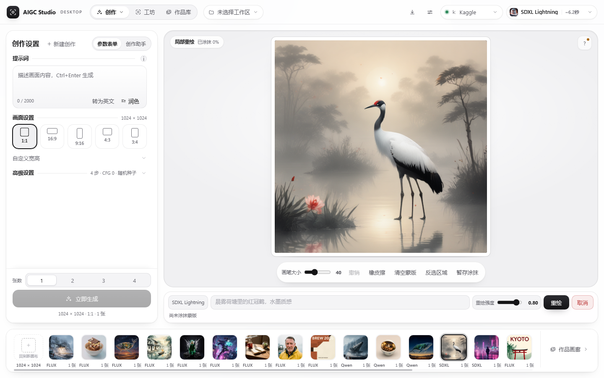
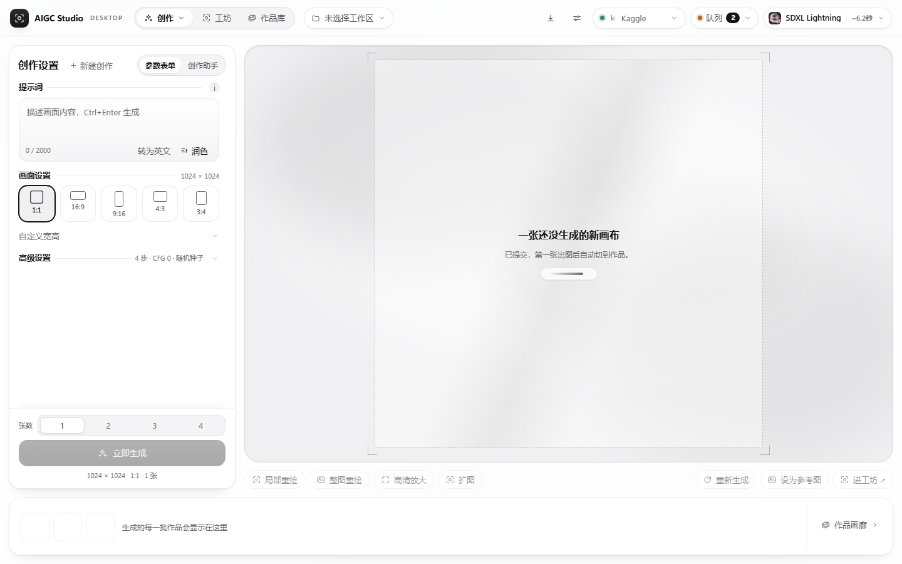
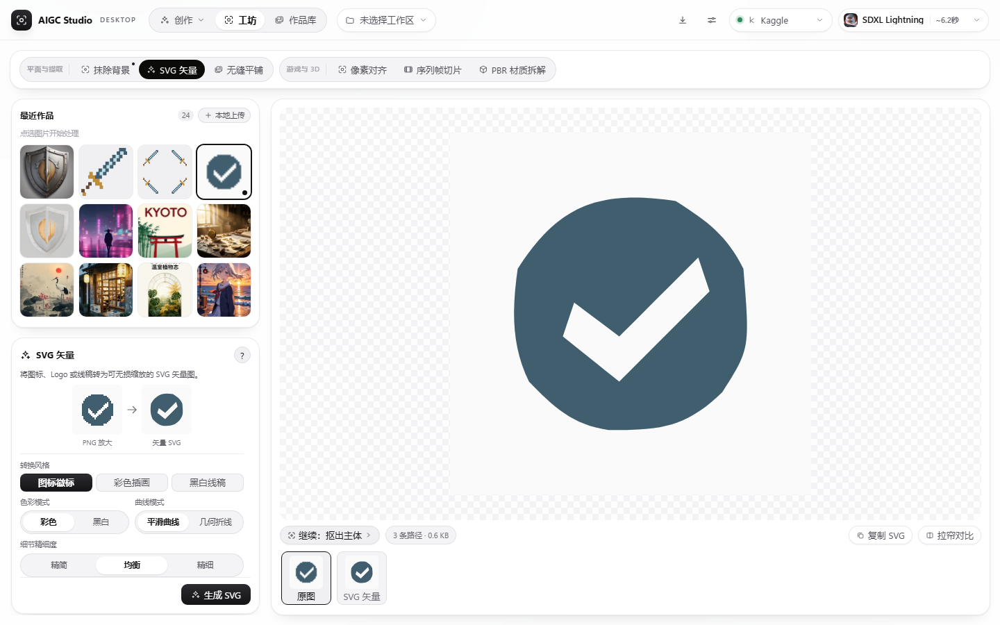
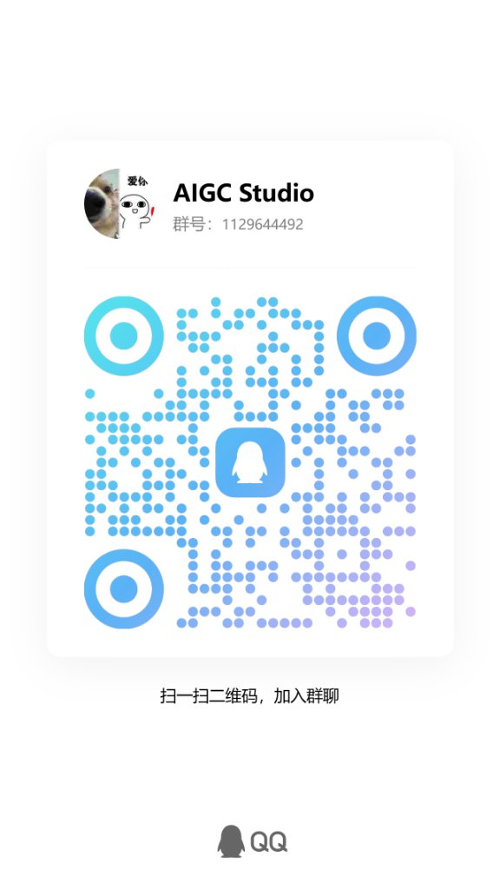

<div align="right"><a href="README.en.md">English</a> · 中文</div>

<div align="center">

# AIGC Studio


**没有独显？没关系，开源生图模型照样跑。**<br/>
一个基于 Electron + React + Node.js 的桌面端 AIGC 工作台。<br/>
不用安装 Python、PyTorch，也不用折腾 ComfyUI。算力可以用 Kaggle / Colab 的免费 GPU，也可以按秒租卡、接商业 API，甚至直接调用本机 AMD / Intel 核显。<br/>
生图、视频、局部重绘、高清放大都能在这里完成。生成的图片还可以继续做像素对齐、背景移除、SVG 转换和 PBR 贴图拆解，不用为了处理一张图在几个软件之间来回切换。<br/>
简单说，就是想办法让手头这台普通电脑，也能玩得起开源 AIGC。

[](https://github.com/nanxfu/aigc-studio/releases)
[](https://aigc-studio-8rj.pages.dev)
[](https://www.electronjs.org/)
[](package.json)
[](https://github.com/nanxfu/aigc-studio)
<a href="https://linux.do/"></a>

[实测样张](#实测样张) · [项目介绍](#项目介绍) · [算力支持](#算力支持) · [内置模型](#内置模型) · [安装与运行](#安装与运行) · [常见问答](#常见问答)

</div>

---
> 本项目仍处于测试阶段，更稳定的交互方式和功能正在持续打磨中...

## 项目介绍

做这个项目，最初其实是因为自己想用开源生图模型，但本地显卡实在有点吃力。

换电脑不现实，自己搭一套 ComfyUI 环境又嫌麻烦。后来发现 Kaggle、Colab 都能提供免费的 GPU，于是干脆做了个桌面端，把这些算力接起来。

现在 AIGC Studio 支持几种不同的运行方式：

- **Kaggle / Colab**：免费额度能用就先用免费额度，适合跑开源模型、批量抽卡。
- **SaladCloud**：需要更大显存时，临时租张卡，按秒付费。
- **商业 API**：不想等 GPU 启动，直接调用在线服务。
- **本机 Vulkan**：AMD、Intel 显卡也能尝试运行部分 GGUF 模型。

另一件让我觉得值得做的事，是生成图片之后的处理。

尤其是做游戏素材时，AI 生成一张像素画只是开始。网格可能歪，颜色可能乱，角色动作还得切帧。原本需要打开好几个软件才能完成的工作，现在可以直接在工坊里处理。

所以这个项目不只是一个生图界面，也把一些生成之后经常要做的小工具放了进来。

工作台里还内置了一个对话助手（支持整理中英文提示词、匹配模型和多轮自动测试），所有生成的原图、视频和 `meta.json` 参数都会保存在本地 `outputs/` 目录，断网也能随时回看。

<div align="center">
  
  <p><sub>主工作台：参数设置、图片预览、局部重绘和历史版本管理</sub></p>
</div>

---

## 实测样张

以下图片均由内置开源模型生成。

测试使用统一的提示词，方便对比不同模型在画面风格、细节和文字生成方面的表现。

[9 维统一盲测提示词](docs/MODEL_BENCHMARK_PROMPTS.md) · [在线同题 A/B 对比](https://aigc-studio-8rj.pages.dev/models)

<table>
<tr>
<td width="50%">
<div align="center">
  
  <p><sub>SDXL Lightning · 雨夜霓虹街道 · Kaggle 2×T4 · 约 9.8 秒</sub></p>
</div>
</td>
<td width="50%">
<div align="center">
  
  <p><sub>FLUX.2 Klein 4B · 极简京都旅行海报 · Kaggle 2×T4 · 约 6.8 秒</sub></p>
</div>
</td>
</tr>
<tr>
<td width="50%">
<div align="center">
  
  <p><sub>FLUX.2 Klein 9B · 黄金时刻钟表匠工作台 · Colab L4 · 113.1 秒</sub></p>
</div>
</td>
<td width="50%">
<div align="center">
  
  <p><sub>SANA-Sprint 1.6B · 红冠鹤与晨间荷塘 · Colab L4 · 4.07 秒</sub></p>
</div>
</td>
</tr>
</table>

<table>
<tr>
<td width="33.3%">
<div align="center">
  
  <p><sub>Z-Image Turbo · 雨巷旧书店 · Colab L4 · 29.19 秒</sub></p>
</div>
</td>
<td width="33.3%">
<div align="center">
  
  <p><sub>Qwen-Image 2.1 · 温室植物志海报 · Colab L4 · 39.25 秒</sub></p>
</div>
</td>
<td width="33.3%">
<div align="center">
  
  <p><sub>Anima Turbo v1.1 · 黄昏海边站台少女 · Colab L4 · 9.81 秒</sub></p>
</div>
</td>
</tr>
</table>

### 多题材创作实测

<table>
<tr>
<td width="33.3%">
<div align="center">
  
  <p><sub>写实人像 · 光影与皮肤质感</sub></p>
</div>
</td>
<td width="33.3%">
<div align="center">
  
  <p><sub>平面海报 · 中英文字排版</sub></p>
</div>
</td>
<td width="33.3%">
<div align="center">
  
  <p><sub>游戏原画 · 二次元角色立绘</sub></p>
</div>
</td>
</tr>
<tr>
<td width="33.3%">
<div align="center">
  
  <p><sub>概念设计 · 大尺度科幻场景</sub></p>
</div>
</td>
<td width="33.3%">
<div align="center">
  
  <p><sub>3D 微缩 · 等距视角箱庭景观</sub></p>
</div>
</td>
<td width="33.3%">
<div align="center">
  
  <p><sub>材质渲染 · 玻璃与晶体折射</sub></p>
</div>
</td>
</tr>
</table>

### 同题盲测横评（中式美学同一提示词）

<table>
<tr>
<td width="25%">
<div align="center">
  
  <p><sub>Qwen-Image 2.1</sub></p>
</div>
</td>
<td width="25%">
<div align="center">
  
  <p><sub>Z-Image Turbo</sub></p>
</div>
</td>
<td width="25%">
<div align="center">
  
  <p><sub>FLUX.2 Klein 4B</sub></p>
</div>
</td>
<td width="25%">
<div align="center">
  
  <p><sub>SDXL Lightning</sub></p>
</div>
</td>
</tr>
</table>

### 编辑工作流实测（局部重绘 / 扩图 / 多图参考 / 高清放大）

<table>
<tr>
<td width="25%">
<div align="center">
  
  <p><sub>局部重绘（Inpaint）</sub></p>
</div>
</td>
<td width="25%">
<div align="center">
  
  <p><sub>扩图（Outpaint LoRA）</sub></p>
</div>
</td>
<td width="25%">
<div align="center">
  
  <p><sub>多图参考（2 Refs）</sub></p>
</div>
</td>
<td width="25%">
<div align="center">
  
  <p><sub>2× 高清放大（Upscale）</sub></p>
</div>
</td>
</tr>
</table>

---

## 算力支持

本地显卡不够用，就把计算任务交给云端。

目前接入了几种算力来源，可以根据模型和任务需要随时切换。

| 算力来源 | 配置 | 费用 | 用途 |
| :--- | :--- | :--- | :--- |
| **Kaggle**（默认） | 2× Tesla T4 | 免费额度 | 日常跑开源模型，能白嫖就先白嫖 |
| **Google Colab** | T4 / L4 / A100 | 免费 / Pro | 跑一些显存要求更高的模型 |
| **SaladCloud** | RTX 3060–A6000 | 按秒计费 | 临时租卡，不用长期养着一张 GPU |
| **商业 API** | 硅基流动 / 魔搭 ModelScope / fal.ai / OpenAI | 按量计费 | 不想等 Worker 启动时直接调用 |
| **私有 Worker** | Linux / RunPod / Vast.ai | 自定 | 已经有服务器或 GPU 的用户 |
| **本机 Vulkan** | AMD / Intel / Nvidia | 无额外算力费用 | 不联网也能跑部分 GGUF 模型 |

Kaggle 默认使用双 T4 环境，每周有 30 小时免费额度。程序会管理云端会话，空闲 30 分钟后自动关机。

还有个容易忘记的地方：云端 GPU 用完一定要关。窗口关闭时，如果任务还在运行，程序会缩到系统托盘；选择「彻底退出」后，会处理对应的云端实例和容器，尽量避免忘记关机、额度白白流失。

<table>
<tr>
<td width="50%">
<div align="center">
  
  <p><sub>顶栏算力来源直切：一键切换免费/按秒/商业/本机算力</sub></p>
</div>
</td>
<td width="50%">
<div align="center">
  
  <p><sub>深色主题模型选择器：按算力分组并显示实测参考</sub></p>
</div>
</td>
</tr>
</table>

---

## 功能细节

### 1. 图片与视频生成

- **图片编辑**：支持局部重绘（Inpaint）、整图重绘、2 倍高清放大、扩图（Outpaint）和多图参考。高清放大优先在本机用 Real-ESRGAN ONNX 分块执行；ModelScope 的 FLUX.2 Klein 可直接做绿边画布扩图。`FLUX.2 Klein`、`Qwen-Image 2.1` 支持带透明通道的多图参考。
- **视频生成**：接入硅基流动 MiniMax H3，支持文生视频和首尾帧生视频。生成后可以直接截取视频首帧或尾帧，作为图片继续编辑。
- **批量任务**：支持一次提交多个任务，队列显示实时推理步数，可以插队或取消。
- **版本管理**：同一张图片经过多次重绘、扩图或放大后，会按修改关系组织成版本树，方便查看和复用。

<table>
<tr>
<td width="50%">
<div align="center">
  
  <p><sub>浅色主题工作台：参数面板 + 实时画布 + 版本胶卷</sub></p>
</div>
</td>
<td width="50%">
<div align="center">
  
  <p><sub>局部涂抹重绘（Inpaint）：画笔遮罩与局部重绘工作流</sub></p>
</div>
</td>
</tr>
</table>

<div align="center">
  
  <p><sub>批量任务队列与实时推理步数回传</sub></p>
</div>

### 2. 创作助手

创作助手可以根据自然语言描述整理提示词、选择模型，并生成出图方案。

- **生成方案**：将中文需求整理为英文提示词，并根据需求推荐模型。正式生成前会展示可编辑的提案卡，需要用户确认后才会提交任务。
- **图片分析**：可以读取已生成的图片，根据画面问题调整下一轮提示词。
- **多轮测试**：设置生成张数和预算后，可以自动运行多轮对比，选出合适的结果继续调整。
- **模型服务**：支持 12 家模型服务商，包括 DeepSeek、Kimi、通义千问、硅基流动、魔搭（ModelScope）、OpenRouter、Gemini、OpenAI、Anthropic 和本地 Ollama 等。配置 API Key 后可以获取对应模型列表。

没有配置大模型 API Key 时，也可以使用内置规则进行提示词整理和补全。

<div align="center">
  
  <p><sub>通过对话整理提示词和生成方案</sub></p>
</div>

### 3. 资产工坊

生成的图片不一定能直接拿来用，尤其是游戏素材。

比如 AI 画出来的像素角色，乍一看挺漂亮，放大后却发现像素网格乱七八糟；角色动作图生成好了，还得自己切帧；一张插画想放进 Figma 继续编辑，又得找工具转 SVG。

这些事情工坊都能处理。

| 工具 | 能做什么 | 输出 |
| :--- | :--- | :--- |
| **像素对齐** | 检测像素网格、整理颜色、清理边缘杂色 | 规整的像素图 |
| **序列帧切片** | 按行列切割角色动作图，支持动画预览 | `spritesheet`、`atlas.json` |
| **无缝平铺** | 处理贴图边缘，减少拼接时的接缝 | 无缝贴图 |
| **SVG 矢量转换** | 将扁平插画转换为可编辑的矢量路径 | `.svg` |
| **抹除背景** | 使用 `BiRefNet` / `RMBG-2.0` 移除背景 | 透明 PNG |
| **PBR 材质拆解** | 从单张图片提取颜色、法线、粗糙度和金属度 | 四张材质贴图 |
| **空间滤镜** | 用深度图实时调雾效、大气透视、景深与 2.5D 视差 | 空间光影成品 + 深度 / 法线通道 |
| **动态打光** | 拖动 3D 光源做物理重打光，或用 `IC-Light` 重绘环境光 | 重打光成品 + 可复用光照通道 |

其中像素对齐、序列帧切片、无缝平铺、SVG 转换、空间滤镜和物理打光都能在本机完成，无需云端显卡；深度图默认使用约 37 MB 的 `DA3-Small` ONNX，背景移除默认内置端侧 `RMBG-1.4`（WebGPU/WASM）并支持云端 `BiRefNet` / `RMBG-2.0`，PBR 材质拆解支持本机 CUDA（8 GB+ N 卡）或云端 GPU，AI 环境光重绘由云端 GPU 执行。

<details>
<summary>关于工坊本地视觉识别的说明（可选组件）</summary>

工坊默认使用本地规则推荐处理工具。

如果开启视觉识别辅助，首次使用时会下载约 22.9 MB 的 MobileCLIP-S0 FP16 权重，用于分析本地 256×256 缩略图，不会上传图片。

该组件受 Apple ML-MobileCLIP License 约束，当前不声明可商用。

如果下载失败，或设置 `AIGC_STUDIO_WORKSHOP_VISION=0`，程序会自动使用基础规则，不影响其他工具。

</details>

<table>
<tr>
<td width="50%">
<div align="center">
  
  <p><sub>PBR 材质拆解：提取反照率、法线、粗糙度与金属度通道</sub></p>
</div>
</td>
<td width="50%">
<div align="center">
  
  <p><sub>SVG 矢量转换：支持路径统计与拉帘前后对比</sub></p>
</div>
</td>
</tr>
</table>

### 4. MCP：接入 Claude Desktop / Cursor

项目内置 MCP Server（[`mcp/server.mjs`](mcp/server.mjs)），可以让 Claude Desktop、Cursor 等支持 MCP 的客户端直接调用本地生图、批量生成和高清放大功能。

MCP Server 会连接正在运行的桌面应用，共用当前算力会话和 `outputs/` 目录。

运行以下命令生成配置：

```powershell
npm run mcp:config
```

具体配置方法见 [MCP 使用说明](mcp/README.md)。

### 5. 本地归档与安全

- **本地保存**：图片、视频和 `meta.json` 生成参数保存在 `outputs/<YYYYMMDD-HHmmss>-<jobId>/`。画廊支持按时间和收藏状态筛选，也可以复用历史图片的生成参数。
- **本地服务**：服务默认监听 `127.0.0.1`，每次启动生成随机认证 Token。
- **密钥存储**：API Key 使用 Electron `safeStorage` 和 AES-256-GCM 加密存储，不以明文写入配置文件。

<div align="center">
  
  <p><sub>本地画廊：查看历史作品、模型和生成参数</sub></p>
</div>

---

## 内置模型

模型配置位于 [`models/`](models/)，目前内置 8 款开源模型。

| 模型 | 特点 | 支持算力 | 开源协议 |
| :--- | :--- | :--- | :--- |
| `SDXL Lightning` | 默认模型，4 步生成，支持图生图和局部重绘 | Kaggle / Colab / Salad / 私有 Worker | OpenRAIL++ |
| `RealVisXL V5 Lightning` | 本机运行，4 步生成，1024² 约 44–49 秒 | Kaggle / Colab / Salad / 私有 Worker / 本机 GPU | CreativeML OpenRAIL++-M |
| `SANA-Sprint 1.6B` | 2 步生成，1024px 约 4 秒，适合快速测试构图 | Kaggle / Colab / Salad / 私有 Worker | Apache-2.0 |
| `FLUX.2 Klein 4B` | 4 步生成，支持中文提示词、多图参考和扩图 | Kaggle / Colab / Salad / 私有 Worker / 本机 GPU | Apache-2.0 |
| `Anima Turbo v1.1` | 2B 二次元模型，支持自然语言和 Danbooru 标签 | Kaggle / Colab / Salad / 私有 Worker | CircleStone Labs 非商用 |
| `Z-Image Turbo` | 6B 写实模型，中英文招牌文字表现较好，支持局部重绘 | Colab / Salad / 私有 Worker / 本机 GPU | Apache-2.0 |
| `Qwen-Image 2.1` | 中文文字排版和海报设计，支持带透明底的多图参考 | Colab / Salad / 私有 Worker | Qwen Research（非商用） |
| `FLUX.2 Klein 9B` | 静物材质和光影表现较好，适合精细编辑 | Colab / Salad / 私有 Worker（需 HF 授权） | FLUX Non-Commercial |

使用商业 API 时，还可以调用以下服务：

- **硅基流动**：`Qwen-Image`、`Kolors`、`FLUX.1`、`MiniMax H3` 视频。
- **魔搭（ModelScope）**：`API-Inference` 在线生图，同时支持模型权重下载镜像源切换。
- **fal.ai**：`FLUX 1.1 Pro`。
- **OpenAI**：`GPT Image 1`、`DALL·E 3`。

---

## 更多教程与对比

- 项目官网：[aigc-studio-8rj.pages.dev](https://aigc-studio-8rj.pages.dev)（[模型实测](https://aigc-studio-8rj.pages.dev/models) · [资产工坊](https://aigc-studio-8rj.pages.dev/workshop) · [全部指南](https://aigc-studio-8rj.pages.dev/guides)）
- 使用教程：
  - [零独显白嫖开源生图模型完整教程](https://aigc-studio-8rj.pages.dev/guides/free-gpu-no-comfyui)
  - [AIGC Studio 和 ComfyUI 分别适合什么人？](https://aigc-studio-8rj.pages.dev/guides/aigc-studio-vs-comfyui)
  - [如何把 AI 像素画整理成游戏可用的序列帧 Atlas](https://aigc-studio-8rj.pages.dev/guides/ai-pixel-art-sprite)
  - [零显存把 AI 插画转成可编辑 SVG](https://aigc-studio-8rj.pages.dev/guides/ai-image-to-svg)
  - [在 Claude Desktop / Cursor 里通过 MCP 直接生图](https://aigc-studio-8rj.pages.dev/guides/mcp-claude-cursor-image)

---

## 安装与运行

### 方式 A：下载安装包（Windows x64）

前往 [GitHub Releases](https://github.com/nanxfu/aigc-studio/releases/latest) 下载：

- `aigc-studio-<version>-x64.exe`：标准安装版，支持桌面快捷方式和应用内检查更新。
- `aigc-studio-<version>-portable.exe`：便携版，无需安装，下载后即可运行。

macOS 和 Linux 用户可以通过源码启动。

### 方式 B：从源码运行（Windows / macOS / Linux）

需要 Node.js ≥ 20，推荐使用 22 或更新版本。只有在自行运行 GPU Worker 或执行 Python 单元测试时，才需要 Python 3.10+。

```powershell
git clone https://github.com/nanxfu/aigc-studio.git
cd aigc-studio

npm install
Copy-Item .env.example .env

# 启动完整桌面客户端
npm run dev
```

如需单独调试前端热更新，也可以分两个终端运行：

```powershell
npm run dev:server          # 终端 1：启动本地服务（默认 127.0.0.1:5130）
npm run dev:web             # 终端 2：启动 Vite 前端（默认 http://127.0.0.1:5173）
```

### 自行打包桌面安装包

```powershell
# 构建免安装目录（输出至 release/win-unpacked/）
npm run pack

# 构建 Windows 安装包与单文件便携版（输出至 release/）
npm run dist
```

### 应用内更新与手动校验

安装版（NSIS）开启「自动检查」后，启动 10 秒检查一次新版本，之后每 6 小时复查；只检查，不自动下载，下载与安装均需确认。便携版、解压版与开发态只提示新版本并打开发布页。设置抽屉 →「版本与更新」可关闭自动检查，或切换为自建 `https://` 更新镜像源。

| 情况 | 说明 |
| :--- | :--- |
| SmartScreen 提示「未知发布者」 | 开源版本暂未购买代码签名证书，属预期行为；确认从本仓库 Releases 下载后，点「更多信息 → 仍要运行」。 |
| 手动校验安装包完整性 | Releases 附 `SHA256SUMS.txt`：Windows 运行 `certutil -hashfile <exe> SHA256`，macOS / Linux 运行 `shasum -a 256 <exe>`，比对摘要。 |
| 云端任务运行时能否安装更新 | 有活跃云端会话或排队任务时，「立即重启安装」会被拦截，避免 Kaggle / Colab 继续消耗额度；可等任务结束或选「退出时安装」。 |
| GitHub 直连较慢或失败 | 可在「版本与更新」填写自定义 `https://` 镜像地址，或开启系统代理。 |

---

## 常见问答

<details>
<summary>Q1: 使用 AIGC Studio 要花钱吗？每周 30 小时免费 GPU 够用吗？</summary>

软件本身以 MIT 协议开源。默认算力来自 Kaggle 向已验证手机号用户提供的每周 30 小时免费 GPU（2×T4，30GB 显存），足够个人日常探索与创作。如需免等待出图或生成视频，可切换硅基流动等按次计费的商业 API。
</details>

<details>
<summary>Q2: 我的电脑需要独立显卡吗？</summary>

不强制需要。默认模型加载和推理在云端执行（Kaggle / Colab / 私有 Worker / 商业 API），本地只负责界面展示、LLM 路由、文件归档，以及零显存的本机工坊后处理。若想完全离线，可在设置中准备本机推理引擎，再从顶栏模型卡按需下载受支持的模型，本机可完成文生图、整图重绘与局部重绘（蒙版）；N 卡会按需使用 CUDA，A 卡 / 核显使用随包 Vulkan。速度取决于显卡带宽与可用显存 / 内存。
</details>

<details>
<summary>Q3: 首次开机为什么要等几分钟？</summary>

Kaggle / Colab 冷启动包括分配云端实例、检查运行环境与拉取模型权重三个步骤，通常需要 3~10 分钟。就绪后连续出图只需数秒；默认空闲 30 分钟自动关机，也可随时手动关机。如需免去冷启动等待，可将算力来源切换为「商业 API」。
</details>

<details>
<summary>Q4: 图片和密钥会传到第三方图床吗？</summary>

不会。远端生成的图片经当次会话的临时 Bearer Token 隧道加密传回本地（或由商业 API 直接下载回本机），随即保存到你指定的工作区 `outputs/` 目录；API Key 与 Worker Token 加密存储在本地系统密钥库。
</details>

---

## 开发与测试

| 操作 | 命令 | 说明 |
| :--- | :--- | :--- |
| 运行全部离线测试 | `npm test` | 含 `contract` / `client` / `host` 与 Electron 有图冒烟 |
| Worker 离线单测 | `python test/worker/run.py` | Python GPU 执行端离线测试 |
| 契约 / 模型 / 图标校验 | `npm run contract:check` / `models:check` / `icons:check` | 校验前后端契约、模型资产与图标完整度 |
| 打包产物冒烟测试 | `npm run test:packaged` / `test:installer` | 校验 `win-unpacked` 目录与 NSIS 静默安装 / 卸载（需先 `npm run dist`） |
| Release 版本与产物校验 | `node tools/check-release-version.mjs` / `npm run release:verify` | 校验 Tag / `package.json` / 契约版本一致性与 `latest.yml` 摘要 |
| Kaggle 环境只读探测 | `npm run kaggle:probe` | 检查本地 Kaggle 凭据与剩余 GPU 配额，不消耗配额 |
| 真机 GPU 验收 | `node test/gpu-live.mjs` | 真实云端 GPU 全链路验收（消耗配额） |

---

## 关注作者与加入社群

- 作者抖音账号：**Lumen流明**（抖音号 `42906749348`）
- **AIGC Studio 交流 QQ 群**：`1129644492`

<div align="center">
  
  
</div>

---

## 开源许可与致谢

- 本项目基于 **MIT License** 开源（见 [`package.json`](package.json)）。
- 感谢 Kaggle 与 Google Colab 为开发者提供云端 GPU 算力支持。
- 感谢 Hugging Face `diffusers`、`@visioncortex/vtracer`、[`pi-ai` / `pi-agent-core`](https://github.com/badlogic/pi-mono) 与各大开源模型团队。
